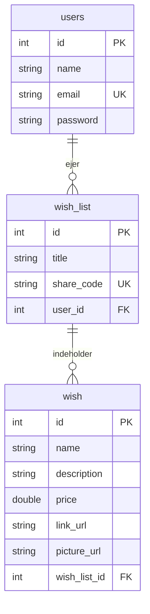

**Ønskeseddel

Ønskeseddel er en webapplikation, hvor brugere kan oprette ønskelister, tilføje ønsker til dem og dele listerne med familie og venner via et link. Applikationen er lavet som semesterprojekt på 2. semester af Datamatikeruddannelsen på Erhvervsakademiet i København.

Link til den kørende applikation

[Indsæt link til den deployede applikation her]

Applikationen er hostet hos [indsæt udbyder], og databasen kører som en MySQL-database hos [indsæt udbyder].

Softwaremæssige forudsætninger
For at bruge applikationen
En almindelig webbrowser (fx Chrome, Firefox, Edge eller Safari)
Internetforbindelse

Der skal ikke installeres noget. Opret en bruger på siden, og log ind.

For at køre applikationen lokalt
Forudsætning	Version / bemærkning
Java (JDK)	17 eller nyere
Maven	Kan også køres direkte fra IntelliJ
MySQL Server	8.x
IDE (valgfri)	Fx IntelliJ IDEA

Database

Databasen består af tre tabeller. En bruger har mange lister, og en liste har mange ønsker. Når en liste slettes, slettes dens ønsker automatisk (ON DELETE CASCADE).

Afgrænsninger
Adgangskoder gemmes i klartekst. I en rigtig applikation skal de hashes.
Det er ikke muligt at reservere ønsker på en delt liste.

Gruppe 1

Mathias, Oliver, Rasmus & Sebastian
